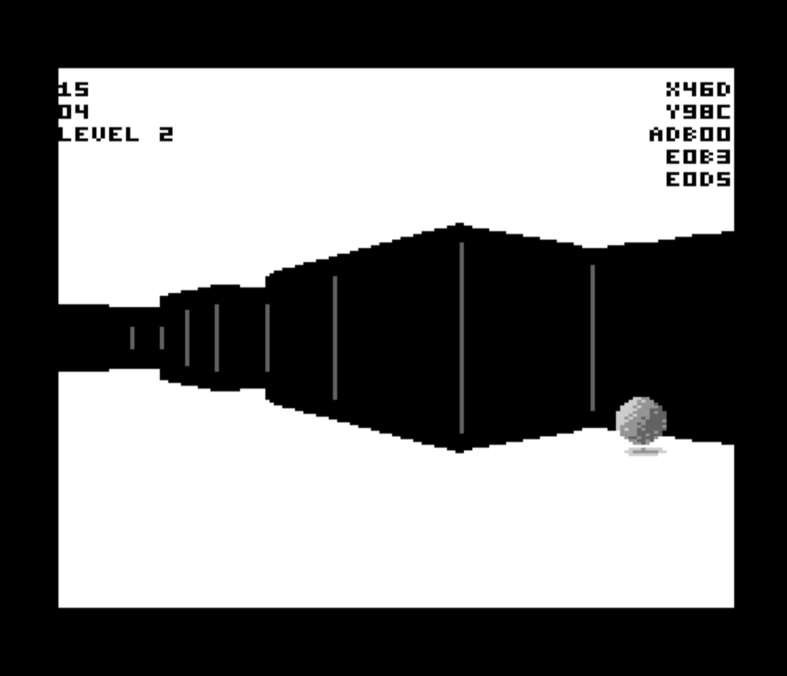

# Lest

A new 3D game for the Commodore 64 

> "He drove out the man, and at the east of the garden he placed cherubim and a
> flaming sword that turned every way…"



## Where it started

> Can an unmodified C64 run a first-person 3D game at full resolution
> with a decent frame rate?

That was the question. And the answer turned out to be: better than I expected.

There have been many 3D games for the C64, even up to including a port of DOOM.
However they all tend to have poor frame rate (under 10 fps) and often very
blocky graphics. My goal was to see if the C64 could produce something smoother
and clearer. And it turned out, it can.

Lots and lots of tricks were used to make it possible:

* screen drawn in character mode instead of bitmap mode
* character map built from sampling millions of rendered frames
* vertically mirrored scene so we only have to calculate the top
* ray cast hinted from previous frame does binary search for corners only
* interpolation of wall edges between corners
* wall seams projected instead of cast
* caching so unchanged areas aren't touched even when moving
* all entities are hardware sprites
* sprites are culled with precalculated zones
* sprites are occluded with per-frame occlusion stamps

And oh so much more. Aggressive profiling and optimizing, pass after pass,
taking advantage of every simplifying rule of our game format, using every
6502 programming trick, precalculating as much math as possible, aligning
tables in memory... you name it, it's in there.

## Playing

You can play it online right now at:

  https://needlestack.github.io/lest-c64/

Or if you prefer, you can use [VICE](https://vice-emu.sourceforge.io/) with
the disk image [`lest-c64.d64`](lest-c64.d64) in this repository, or the
cartridge image [`lest-c64.crt`](lest-c64.crt) (see below).

Be sure to use **x64sc** and enable **true drive emulation** under
peripherals: the fast loader runs its own code inside the 1541, so it needs a
real (or truly emulated) drive. The same disk runs on NTSC and PAL machines (it
detects which at boot), but it plays slightly better on NTSC, so set the
machine to **NTSC** if you can.

**The cartridge.** [`lest-c64.crt`](lest-c64.crt) is the same game as an
EasyFlash cartridge image, for an EasyFlash 3, Kung Fu Flash, Ultimate 64 or
1541 Ultimate, or any emulator (in VICE: `x64sc -cartcrt lest-c64.crt`). It
needs no disk drive at all, so it is the way to play on a machine whose drive is
an SD2IEC, which the disk's fast loader cannot talk to. It loads in under a
second; the opening quote and title then hold for a few seconds each, and fire or
SPACE skips them.

**Controls**

| | keyboard | joystick (port 1) |
|---|---|---|
| forward, back | E, D | up, down |
| turn left, right | `,` `.` (the `<` `>` keys) | left, right |
| strafe left, right | S, F | hold the button + left, right |
| pick up, put down | SPACE | button |
| start again (after you're caught, or at the end) | SPACE | button |

Picking up and putting down happen when you let go of SPACE or the button,
unless you strafed while holding it.

On a real C64 plug the joystick into port 1. In VICE, map the cursor keys or a
gamepad to joystick port 1. The online version is already set up that way.

## Building

Requirements:

- a recent [Node.js](https://nodejs.org/) (developed on 26)
- [ImageMagick](https://imagemagick.org/) 7 (`magick` on the path; the build
  fits sprite art from the images in `art/`)
- for the music, **GoatTracker 2 (v2.76) with this project's patch to its
  player**: the build packs every song with its `gt2reloc`. Using the
  macOS-buildable fork:

  ```sh
  git clone https://github.com/joelricci/goattracker2 ~/goattracker2
  cd ~/goattracker2 && git checkout 3885f28    # the commit LEST is built with
  cd src
  patch player.s < /path/to/lest-c64/music/goattracker-player.patch
  make            # macOS: needs `brew install sdl12-compat` and the Xcode command-line tools
  ```

  (`gt2reloc` carries the player inside it, so the patch goes in before `make`.)

  The build looks for `~/goattracker2/linux/gt2reloc`; set `GT2RELOC` to use
  another. A stock GoatTracker is not enough (the build checks for the patch).
  `MUSIC=0` builds without music, and without needing GoatTracker.

The assembler (`src/asm6502.mjs`) and the disk-image writer (`src/d64lib.js`)
are part of the project. The test tools in `tools/` also need
[VICE](https://vice-emu.sourceforge.io/) 3.9; they look for
`/Applications/vice-arm64-gtk3-3.9/bin/x64sc`, and `X64SC` names another.

```sh
node src/build-iray.mjs                               # the whole game, levels 1-10 -> lest-c64.d64 and lest-c64.crt
D64=build/test.d64 node src/build-iray.mjs            # the same, to another disk
```

Every disk is the whole game, starting at level 1. `D64` names the disk to write;
without it, any build replaces `lest-c64.d64`. Each level and each removable wall
is built as its own sub-build first, so the engine can be laid out around all of
them; the sub-builds run in parallel and are cached in `build/.cache/` under a hash
of every input they read (src/, data/, art/, music/, krill/, the environment, node
and ImageMagick), so a build is about 25 s cold and 5 s when nothing they
depend on has changed. `NOSUBCACHE=1` makes them all fresh; deleting `build/.cache/` is
always safe. Run it from the project directory.

[`docs/TESTING.md`](docs/TESTING.md) says which test answers which question
(does it still play, does it still draw the same, did a routine get faster) and
how to run it.

The online version is [`index.html`](index.html), served from this repository
by GitHub Pages. It runs [EmulatorJS](https://emulatorjs.org/) (pinned, from
its CDN) set up for NTSC, true drive emulation, joystick port 1 and the whole
keyboard to the C64, and plays `lest-c64.d64` straight from the repository, so
pushing a new disk updates the site.

## How it works

The screen is a character-mode **framebuffer**: 40×25 cells, each drawn from a
charset of wall-edge shapes, giving 160×200 multicolour pixels. Around it:

- **Memory**: the image is laid out by a build-time compactor, code from the
  bottom and tables from the top. Levels load from disk on demand, through
  Krill's loader, into one slot. A level brings its own code with it, so a
  feature only one level uses (level 8's failing light, level 10's ball
  lightning) costs the others nothing.
- **Boot**: a two-stage loader. A few hundred bytes at the stock drive speed
  get the 1541 running its own small transfer routine, read straight off the
  disk, which brings in the loading screen and Krill's installer quickly; Krill
  then loads everything else, laid out at its native interleave. Drives that
  are not a 1541 take the stock route automatically.
- **Cartridge**: the disk's own files, byte for byte, in EasyFlash banks, and
  a 251-byte loader that stands in for Krill's resident at the same address
  with the same calling convention, so the game cannot tell which medium it
  came from (`src/cart-src.mjs`).

The build also checks itself as it goes. Page alignment, memory overlaps,
zero-page ownership, unreachable code, and the precondition of every
undocumented opcode it uses are verified before a disk is written.

Deeper notes: [`docs/RENDERING.md`](docs/RENDERING.md) on the renderer. Every entity's
size ladder, drawn rung by rung at the C64's pixel aspect, is in
[`docs/ladders/`](docs/ladders/) (regenerate with `LADDERSHEET=1 node
src/build-iray.mjs`).

## Layout

| path | what |
|---|---|
| `lest-c64.d64` | the game, ready to play |
| `lest-c64.crt` | the same game as an EasyFlash cartridge |
| `index.html` | the game in a browser (EmulatorJS), served by GitHub Pages |
| `src/build-iray.mjs` | the game: emits 6502 assembly, builds every level, writes the disk |
| `src/levels.mjs` | the ten levels as data: maps, walls, sockets, exits, entities, starts, inks (read by the build and by `tools/levelsheet.mjs`) |
| `src/compact.mjs` | the image layout pass (run by the build) |
| `src/loader-src.mjs` | the boot: autorun, fast first stage, quote, Krill's installer |
| `src/cart-src.mjs` | the cartridge: its boot, loader and `.crt` writer |
| `src/ending-src.mjs` | the ending: end quote, the tree dissolving in, and the reload |
| `src/asm6502.mjs`, `src/d64lib.js` | assembler and disk writer |
| `src/fit-*.mjs`, `src/make-*.mjs`, `src/charsetgen.mjs`, `tools/endscene.mjs`, `tools/build-facetest3.mjs` | the art converters: the `fit-*` ones run inside every build, the rest by hand to make the assets in `data/` (see `docs/ASSETS.md`) |
| `data/` | assets made by hand from `art/` that the build reads (death picture, quotes, title, pedestal, end scene, charset plan) |
| `build/` | build output; only `build/iray.asm` is committed, so a diff shows what a change did to the machine code |
| `art/` | source art: every picture in the game starts here (`docs/ASSETS.md` says how); `art/tree/` is the end scene's |
| `krill/` | Krill's loader, prebuilt |
| `docs/` | `TESTING.md`, THE tests: what to run for which question and how to read it; `SPACE.md`, where the image's bytes go; `RENDERING.md`; `levels/`, every level as a sheet (key in `levels/KEY.txt`, regenerate with `node tools/levelsheet.mjs`); and `ladders/`: every entity's ladder of sprite sizes, as pictures |
| `tools/` | live-machine inspection (`probe`), frame-rate and cycle benchmarks (`fpsr`, `prof`, `vprof`), test rigs (`regress.sh`, `ship.sh`, `frames`), the level sheets (`levelsheet`), and the music tools (`song-*`, `sidtrace`) |

## Credits and licence

Everything in this repository -- the code, the art in `art/`, the end-scene
picture and the level designs -- by Jonathan Field, written with Claude
(Anthropic) in Claude Code, is released under the [MIT licence](LICENSE).

Included third-party code keeps its own licence:

- **Loader by Krill** (Gunnar Ruthenberg), BSD 3-clause. See [`krill/README-krill`](krill/README-krill).
- **The fast first stage** (`IFBT`/`IDRV` in `src/loader-src.mjs`) adapts the idea of [fastboot1541](https://github.com/mist64/fastboot1541) by Michael Steil: have the drive read its own code off the disk, so almost nothing crosses the slow bus before a fast loader is running.
- **Exomizer decruncher** by Magnus Lind ([`src/exodecrunch.asm`](src/exodecrunch.asm)), under the notice in that file.
