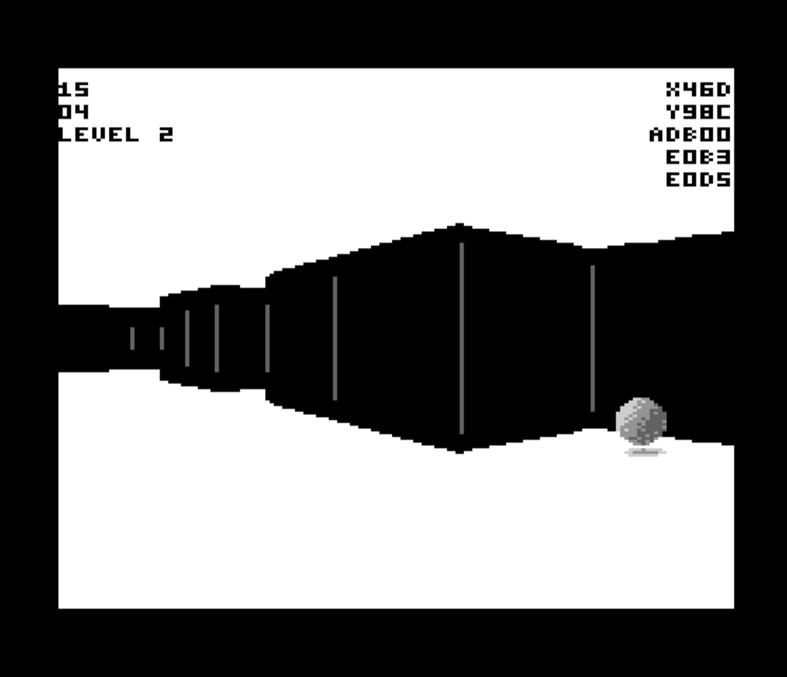

# Lest

A first-person game for the Commodore 64: smooth 3D at 10–20 frames per second,
at full resolution.

> "He drove out the man, and at the east of the garden he placed cherubim and a
> flaming sword that turned every way…"



## Where it started

> Can an unmodified C64 run a first-person-shooter style game full screen at a
> good frame rate? Bitmap mode won't work. What if we used character mode, with
> every possible combination of 4x2 chunky pixels represented? Could that render
> 3D at 30 fps?

That was the whole question, and the project was called *c64fps* while it was
only a question. The answer turned out to be "nearly, differently, and better".
The charset of 4×2 chunky pixels became native multicolour cells. Instead of
holding every pattern, the charset holds the 243 shapes a wall edge actually
makes, fitted from millions of sampled views. The frame rate settled at 10–20
fps on a stock machine. Somewhere along the way it became a game.

## Playing

You need a C64, or [VICE](https://vice-emu.sourceforge.io/) (`x64sc`), and the
disk image [`lest-c64.d64`](lest-c64.d64) in this repository, or one you build
yourself (below). It's built and timed for **NTSC** machines.

**Basic Controls**

* On a stock C64 just use Joystick 1.
* On VICE set the cursor keys to Joystick 1.

Directions get you Forward/Backward and Turn Left/Right.

Button or Spacebar Picks up / Puts down objects.

You can also use ESDF to go forward/backward and strafe left/right.

**You can also hold shift to run.**

After you're caught, press RETURN to start again.

The loader talks to a real 1541. In VICE, keep **True Drive Emulation** on (the
default).

## Building

Requirements: a recent [Node.js](https://nodejs.org/) (developed on 26), and
[ImageMagick](https://imagemagick.org/) 7 (`magick` on the path; the build fits
sprite art from the images in `art/`). There's no other toolchain: the
assembler (`src/asm6502.mjs`) and the disk-image writer (`src/d64lib.js`) are
part of the project.

```sh
node src/build-iray.mjs                 # the whole game -> lest-c64.d64
CHAIN=4 node src/build-iray.mjs         # one level on its own, for playtesting
```

`CHAIN` lists the levels on the disk, in order. A full build takes under 20
seconds: each level and each removable wall is built as its own sub-build
first, so the engine can be laid out around all of them. Run it from the
project directory.

## How it works

The screen is a character-mode **framebuffer**: 40×25 cells, each drawn from a
charset of wall-edge shapes, giving 160×200 multicolour pixels. Each frame:

- **Rays** are cast only where the picture can change: last frame's wall
  boundaries seed the subdivision, so a typical view needs around 14 rays
  rather than 160, and the columns between are interpolated.
- **Walls** become cell codes through tables. A wall's top edge in a cell is a
  ramp, a step or a level, and the charset was chosen by measuring which of
  those the engine really draws.
- **Seams**, the lines between wall panels, are painted in a reserved colour by
  one divide per seam.
- **Entities** (orbs, statues, idols, sockets, exits) are hardware sprites.
  Each is scaled from a ladder of pre-fitted sizes and hidden behind walls by
  per-frame occluder masks.
- **Memory**: the image is laid out by a build-time compactor, code from the
  bottom and tables from the top. Levels load from disk on demand, through
  Krill's loader.
- **Boot**: a two-stage loader. A few hundred bytes at the stock drive speed
  get the 1541 running its own small transfer routine, read straight off the
  disk, which brings in the loading screen and Krill's installer quickly; Krill
  then loads everything else, laid out at its native interleave. Drives that
  are not a 1541 take the stock route automatically.

The build also checks itself as it goes. Page alignment, memory overlaps,
zero-page ownership, unreachable code, and the precondition of every
undocumented opcode it uses are verified before a disk is written.

Deeper notes: [`docs/RENDERING.md`](docs/RENDERING.md) on the renderer. Every entity's
size ladder, drawn rung by rung at the C64's pixel aspect, is in
[`docs/ladders/`](docs/ladders/) (regenerate with `LADDERSHEET=1 node
src/build-iray.mjs`).

## Layout

| path | what |
|---|---|
| `lest-c64.d64` | the game, ready to play |
| `src/build-iray.mjs` | the game: emits 6502 assembly, builds every level, writes the disk |
| `src/compact.mjs` | the image layout pass (run by the build) |
| `src/loader-src.mjs` | the boot: autorun, fast first stage, quote, Krill's installer |
| `src/ending-src.mjs` | the ending: end quote, the tree dissolving in, and the reload |
| `src/asm6502.mjs`, `src/d64lib.js` | assembler and disk writer |
| `src/fit-*.mjs`, `src/make-*.mjs`, `src/charsetgen.mjs`, `tools/endscene.mjs` | hand-run generators that produce the assets in `data/` |
| `data/` | fitted assets the build reads (sprites, charset plan, quotes, end scene) |
| `build/` | build output; only `build/iray.asm` is committed, so a diff shows what a change did to the machine code |
| `art/` | source art: renders, paintings and hand-drawn sprites; `art/tree/` is the end scene's |
| `krill/` | Krill's loader, prebuilt |
| `docs/` | `RENDERING.md`, and `ladders/`: every entity's ladder of sprite sizes, as pictures |
| `tools/` | live-machine inspection (`probe`), frame-rate and cycle benchmarks (`fpsr`, `prof`, `vprof`), test rigs (`ship.sh`, `frames`) |

## Credits and licence

Everything in this repository -- the code, the art in `art/`, the end-scene
picture and the level designs -- by Jonathan Field, written with Claude
(Anthropic) in Claude Code, is released under the [MIT licence](LICENSE).

Included third-party code keeps its own licence:

- **Loader by Krill** (Gunnar Ruthenberg), BSD 3-clause. See [`krill/README-krill`](krill/README-krill).
- **The fast first stage** (`IFBT`/`IDRV` in `src/loader-src.mjs`) adapts the idea of [fastboot1541](https://github.com/mist64/fastboot1541) by Michael Steil: have the drive read its own code off the disk, so almost nothing crosses the slow bus before a fast loader is running.
- **Exomizer decruncher** by Magnus Lind ([`exodecrunch.asm`](exodecrunch.asm)), under the notice in that file.
